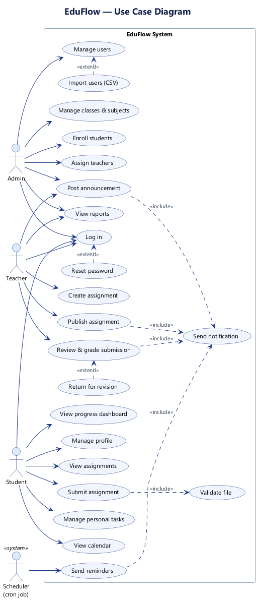
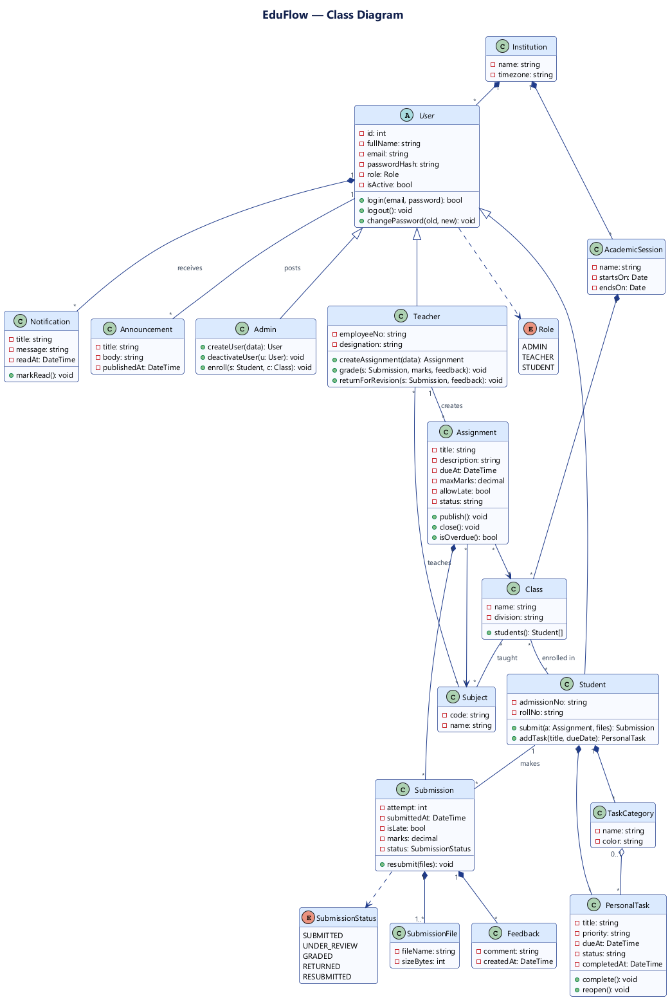
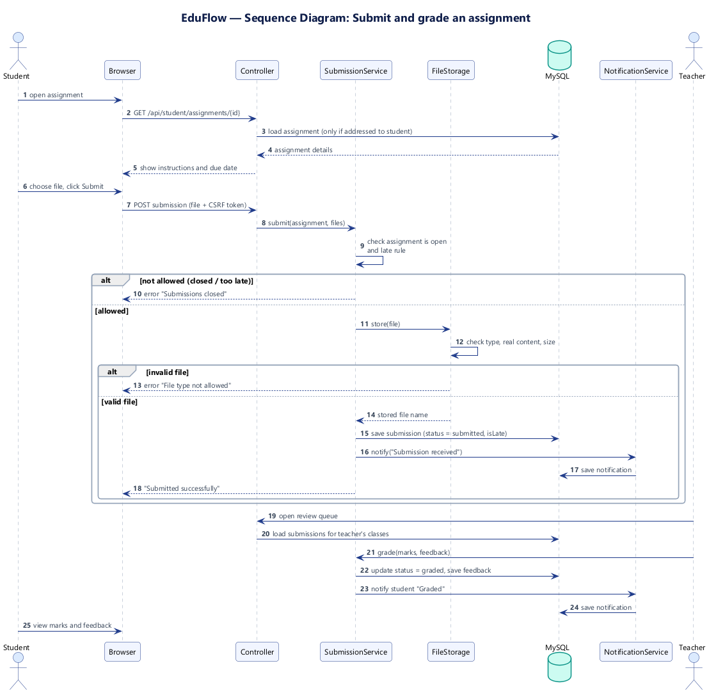
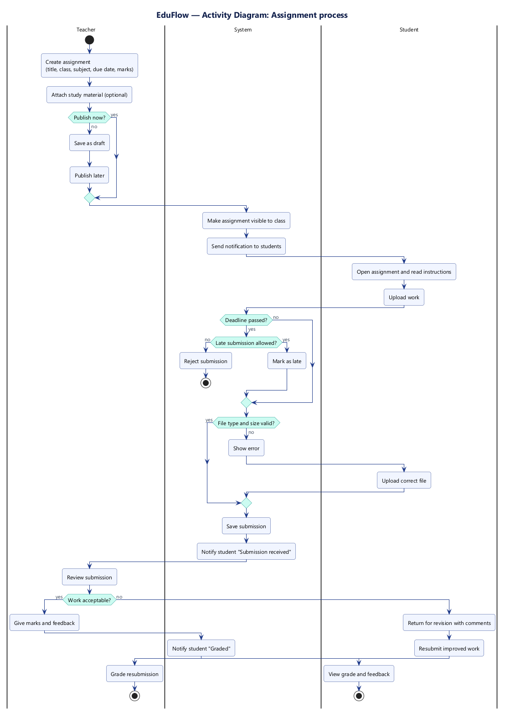
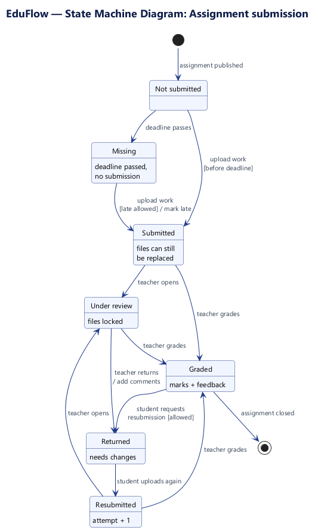
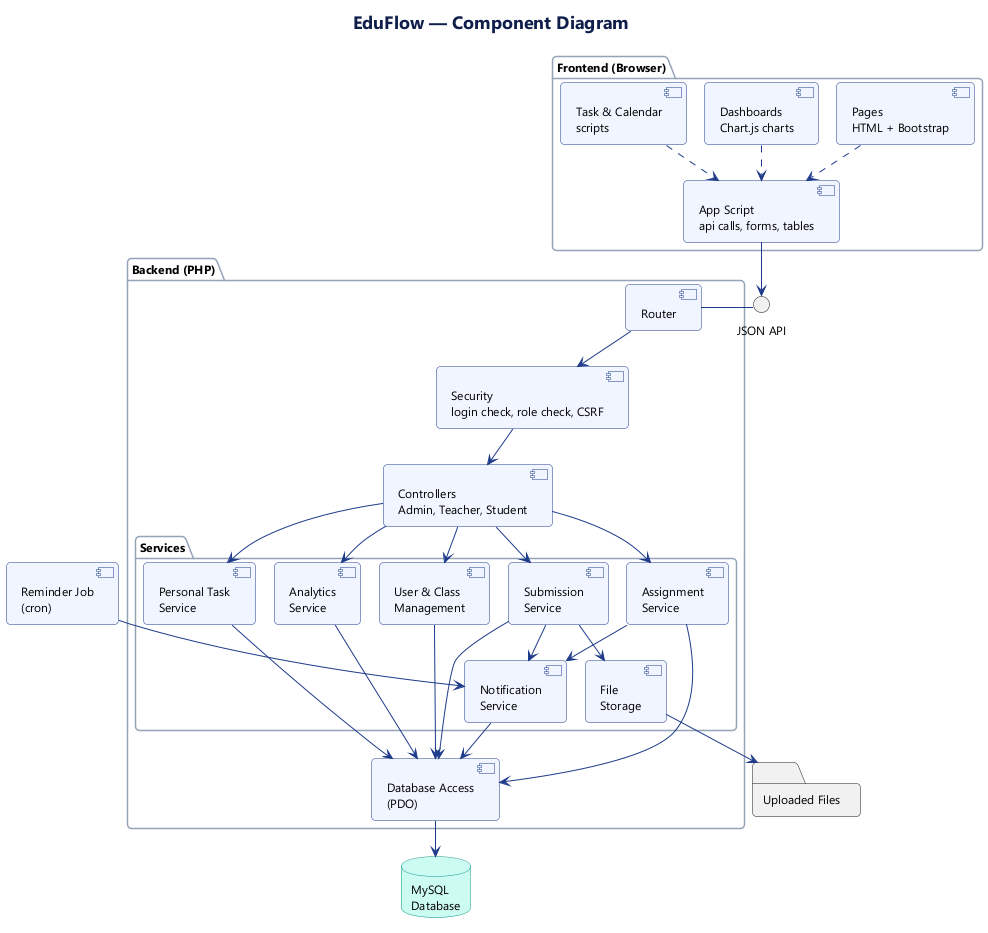
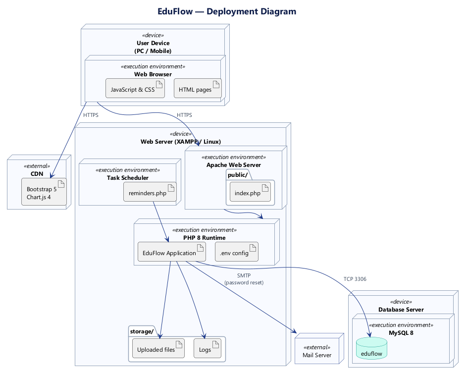

# EduFlow — UML Diagrams

## 1. Use Case Diagram

## 2. Class Diagram

## 3. Sequence Diagram — Student submits an assignment

## 4. Activity Diagram — Assignment process

## 5. State Machine Diagram — Assignment submission

## 6. Component Diagram

## 7. Deployment Diagram

More detailed versions (15 diagrams) are in [detailed/](detailed/README.md).
