# EduFlow — UML Diagrams

UML models of the EduFlow academic management and productivity portal, drawn from the actual
implementation in this repository (PHP 8, MySQL 8, Bootstrap + Chart.js).

| # | Diagram | What it shows |
|---|---|---|
| 1 | [Use case](#1-use-case-diagram) | Actors (Admin, Teacher, Student, Scheduler, Mail server) and their goals |
| 2a | [Class — domain model](#2a-class-diagram--domain-model) | Entities, attributes, operations, associations, inheritance, multiplicities |
| 2b | [Class — application layer](#2b-class-diagram--application-layer) | Core framework, middleware, controllers, services and their dependencies |
| 3a–3d | [Sequence](#3-sequence-diagrams) | Log in · Publish an assignment · Submit work · Grade or return work |
| 4a–4b | [Activity](#4-activity-diagrams) | Assignment workflow across swimlanes · Quick-add a personal task |
| 5a–5d | [State machine](#5-state-machine-diagrams) | Assignment · Submission · Personal task · User account |
| 6 | [Component](#6-component-diagram) | Browser scripts, PHP components, database and storage |
| 7 | [Deployment](#7-deployment-diagram) | Devices, execution environments, artifacts and protocols |

Sources are PlantUML (`*.puml`, shared style in `_style.iuml`). Images are in `images/` as PNG
(for documents) and SVG (scalable, for screens and printing).

---

## 1. Use Case Diagram

Admin, Teacher and Student specialise a common **User** (log in, profile, notifications,
announcements). The **Scheduler** (cron job) is a system actor that sends reminders.
`<<include>>` marks steps that always happen (publishing always notifies recipients; every upload
is validated); `<<extend>>` marks optional behaviour (CSV import, quick-add, reminders,
return for revision, resubmission request).

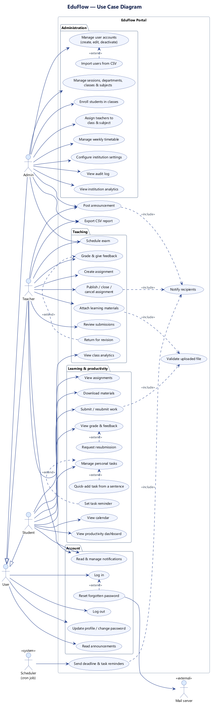

## 2a. Class Diagram — domain model

The data the system manages. `Teacher`, `Student` and `Admin` inherit from `User`.
`Enrollment` and `TeacherAssignment` are association classes for the many-to-many links
Class↔Student and Class↔Subject (taught by a teacher). Composition (filled diamond) means the part
cannot exist without the whole, e.g. a `Submission` owns its files, feedback and grading history.

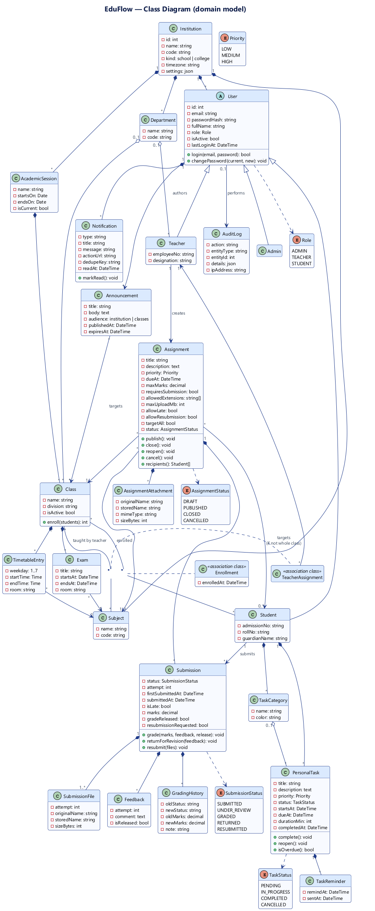

## 2b. Class Diagram — application layer

How the code is organised: requests go through `Kernel` → `Router` → `Middleware` →
controllers → services → `Database`. `Policy` holds all scope and ownership rules;
`Recipients` is the single definition of who an assignment is for.

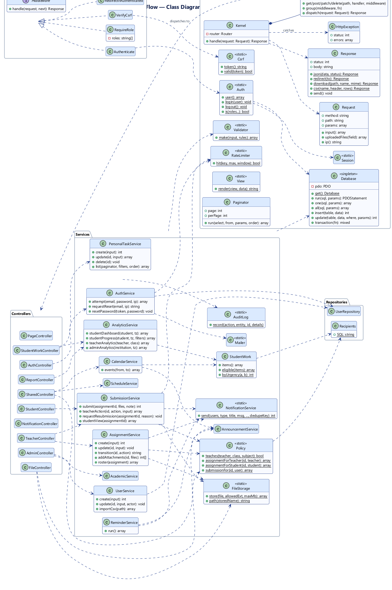

## 3. Sequence Diagrams

### 3a. Log in
CSRF check, rate limiting, constant-time password check, session id regeneration and role-based
redirect.

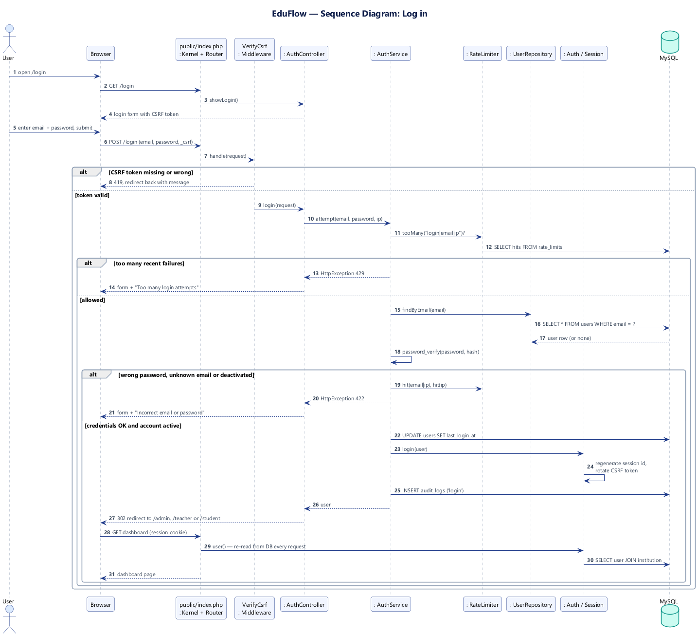

### 3b. Teacher creates and publishes an assignment
Scope check (teacher must teach the class and subject), transaction, state change and
de-duplicated notifications to each recipient.

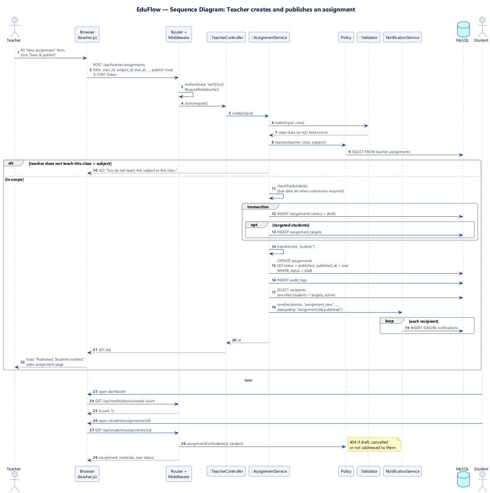

### 3c. Student submits an assignment
Visibility and late-policy checks, upload validation, private storage, and the three submission
modes (new, update before review, resubmit after return).

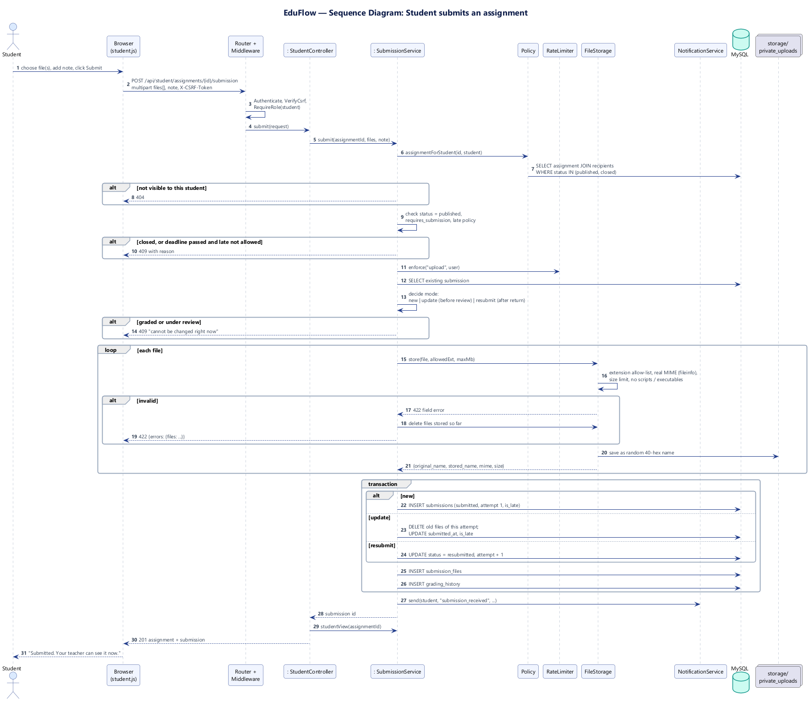

### 3d. Teacher grades or returns work
Review queue, authorized download, grading with optional release, or return for revision, with
history and notifications.

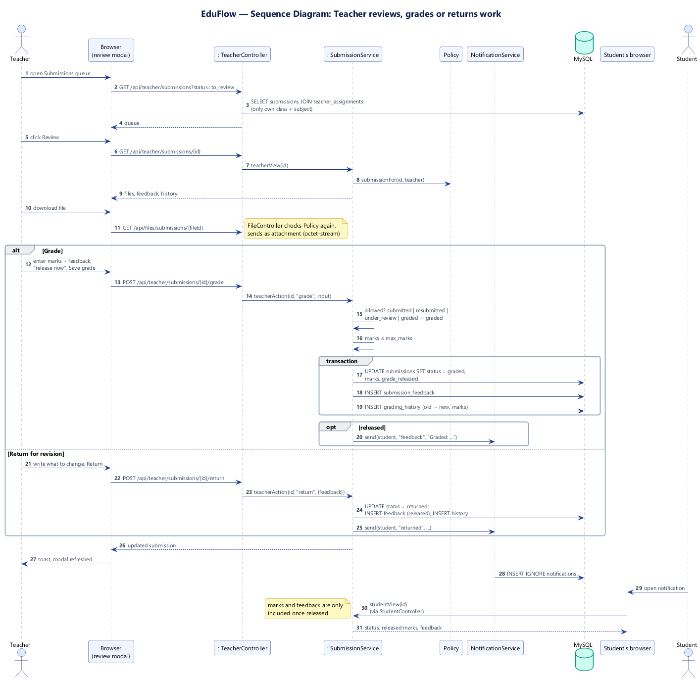

## 4. Activity Diagrams

### 4a. Assignment workflow
Swimlanes for Teacher, System and Student from creation through submission, grading and
resubmission.

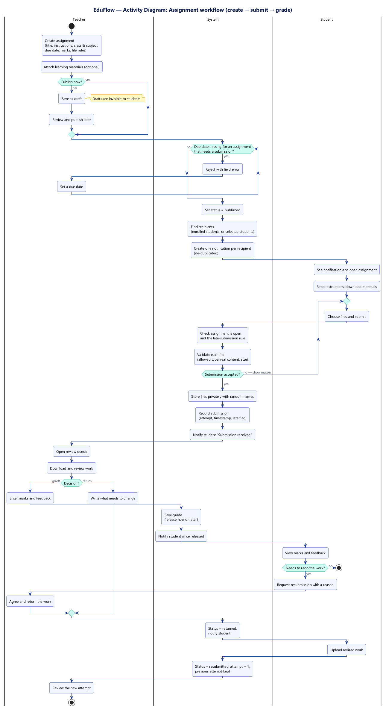

### 4b. Quick-add and complete a personal task
The sentence parser runs in the browser (fork/join for the independent parsing rules), then the
server validates and stores the task.

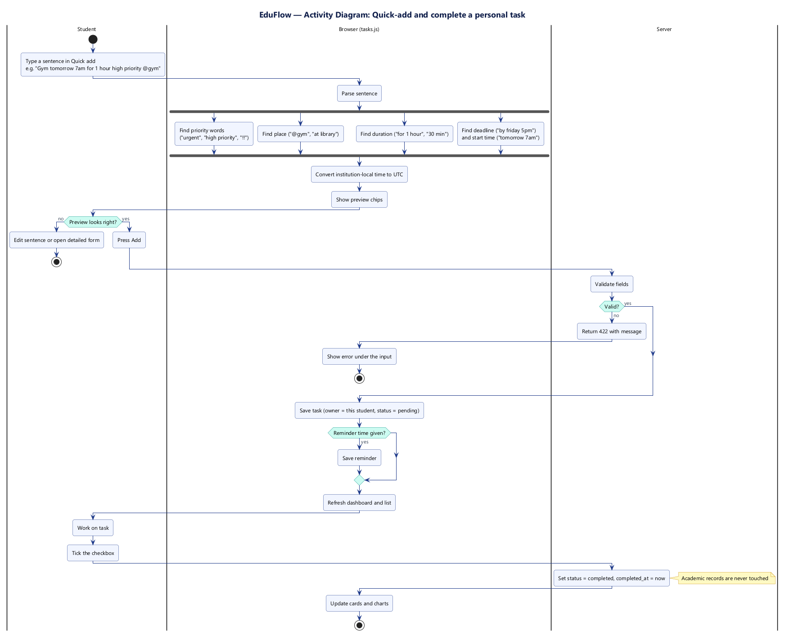

## 5. State Machine Diagrams

### 5a. Assignment (publication state)
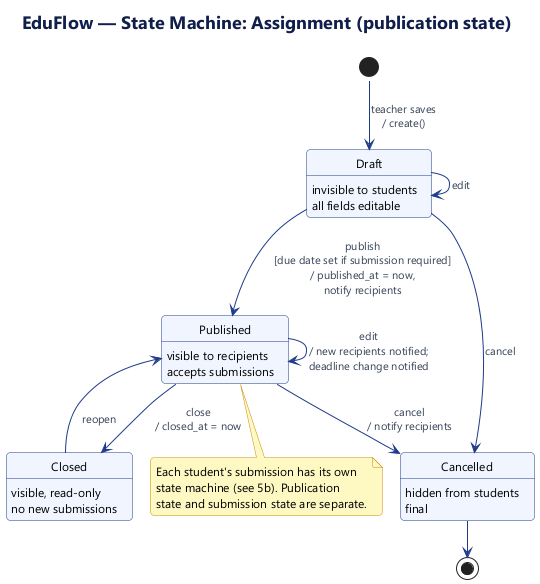

### 5b. Submission (per student)
Kept separate from the assignment's state: one assignment can be *published* while each student's
submission is in a different state.

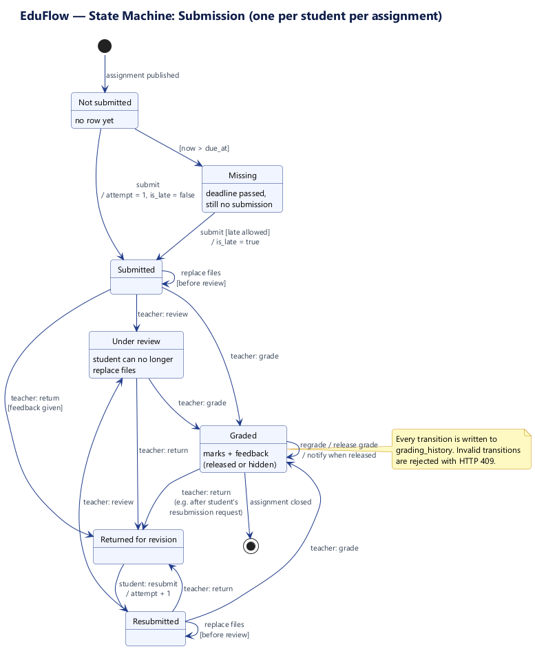

### 5c. Personal task
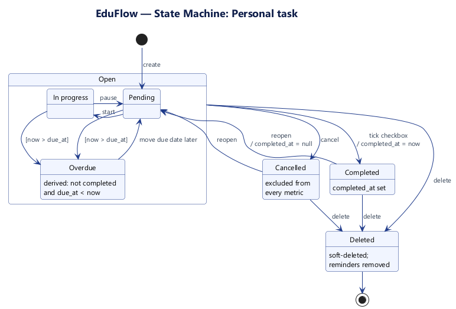

### 5d. User account and session
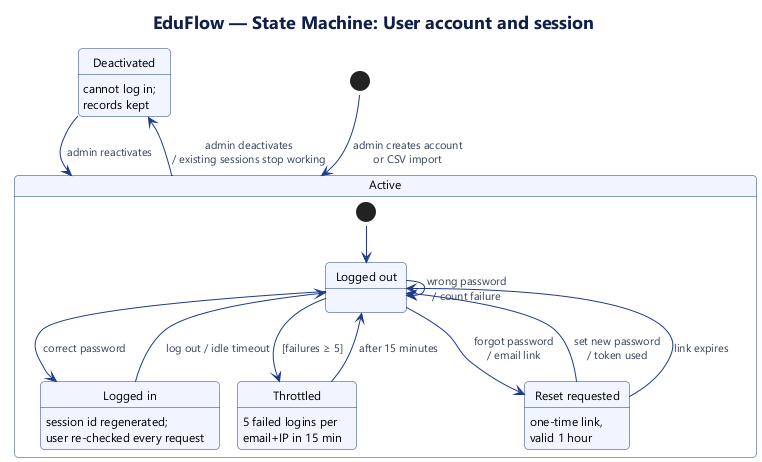

## 6. Component Diagram

Browser-side scripts call the JSON API through `app.js`; the PHP application is split into
front controller, routing, middleware, controllers, services and core. MySQL, private file storage
and logs are external to the code.

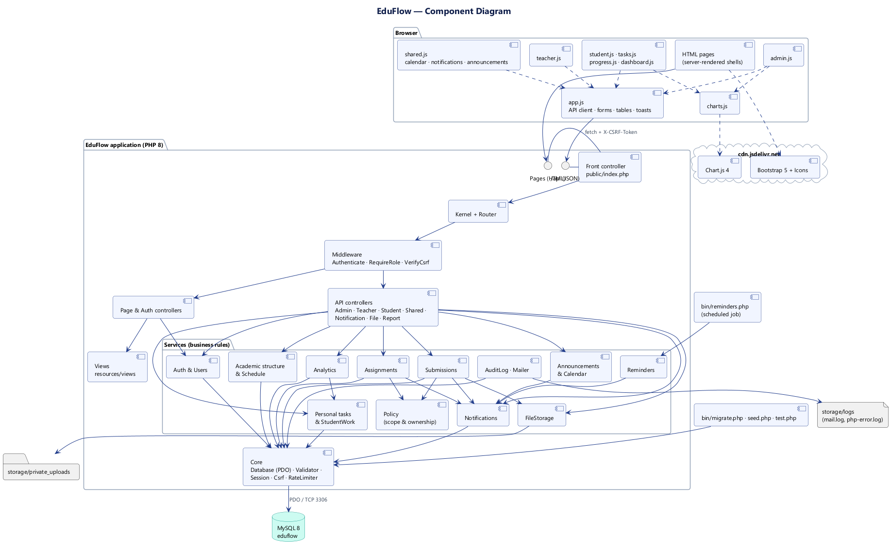

## 7. Deployment Diagram

A browser on the user's device talks HTTPS to Apache (or PHP's built-in server in development)
whose document root is `public/`. PHP connects to MySQL over TCP 3306 with a least-privilege
user. Uploads live in `storage/`, outside the web root. A scheduler runs `bin/reminders.php`
every 15 minutes.

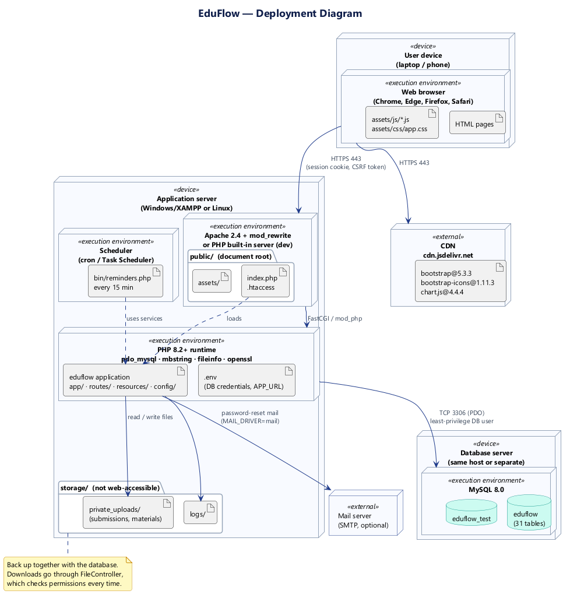

---

### Regenerating the images

```bash
# needs Java 11+ and plantuml.jar (https://plantuml.com/download); Graphviz is not required
java -jar plantuml.jar -tpng -o images docs/uml/*.puml
java -jar plantuml.jar -tsvg -o images docs/uml/*.puml
```
